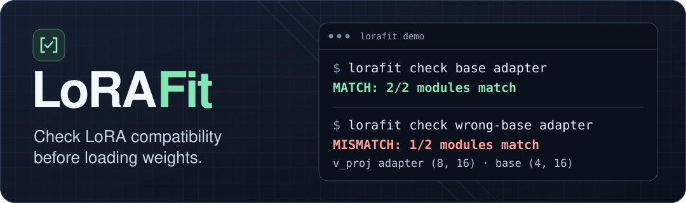

# LoRAFit



**Find mismatches between a PEFT LoRA adapter and a local SafeTensors base before you load the model.**

[](https://github.com/nazek52/lorafit/actions/workflows/ci.yml) [](https://github.com/nazek52/lorafit/releases/latest)  [](LICENSE)

[Try the demo](#quickstart) · [Download the wheel](https://github.com/nazek52/lorafit/releases/download/v0.2.0/lorafit-0.2.0-py3-none-any.whl) · [Check your files](#use-your-checkpoints) · [CI and scripting](#ci-and-scripting)

Swapped your base checkpoint? `lorafit` checks the adapter's tensor names, shapes and rank by reading the SafeTensors headers. It reports the exact module that differs. The check runs offline with no GPU or runtime dependencies.

## Quickstart

With Python 3.10 or newer, install the wheel from GitHub and run the included demo.

```sh
python -m pip install https://github.com/nazek52/lorafit/releases/download/v0.2.0/lorafit-0.2.0-py3-none-any.whl
lorafit demo
```

The demo checks the same adapter against two tiny synthetic bases that it creates locally.
To install from a checkout, run `python -m pip install .` at the repo root. For an offline install from a downloaded wheel, see the [release notes](docs/release-notes-v0.2.0.md).

<details>
<summary>Full output of the demo</summary>

```text
$ lorafit check base adapter
MATCH: 2/2 modules match; read 2/2 base headers

$ lorafit check wrong-base adapter
MISMATCH: 1/2 modules match; read 2/2 base headers
  shape_mismatch: 'model.layers.0.self_attn.v_proj': adapter B @ A gives (8, 16); base weight is (4, 16)
```

</details>

## Use your checkpoints

```sh
lorafit check ./base-model ./adapter
```

| Input | Pass to `lorafit check` |
| --- | --- |
| Base | A directory with `model.safetensors` or `model.safetensors.index.json`, or an explicit weights or index file. |
| Adapter | A directory with `adapter_config.json` and `adapter_model.safetensors`. |

For a sharded base, LoRAFit opens only the shards listed for the adapter's targets. Index entries use portable shard filenames in the same directory. Pass an explicit file to select a variant, such as `./base-model/model.fp16.safetensors`. See the [runnable examples](examples/) for a fixture you can edit and a round trip using Transformers and PEFT.

## CI and scripting

```sh
lorafit check ./base-model ./adapter --format json
```

| Exit | Status | Meaning |
| --- | --- | --- |
| `0` | `match` | Stored adapter pairs match the names, shapes and rank. |
| `1` | `mismatch` | A target, shape, rank or pair differs. |
| `2` | `incomplete` | A required input is unusable or outside the supported layout. |

The [JSON report guide](docs/report.md) lists finding codes for scripting. Text output shows up to 12 findings by default. Set `--max-findings` to change the limit.

## Scope

LoRAFit supports standard PEFT LoRA pairs on dense floating-point matrices with a uniform rank. The result describes structural fit. Confirming the training base's exact revision or checking inference behavior requires separate evidence.

| Tool | Use it for |
| --- | --- |
| **LoRAFit** | Check one adapter against one local base before starting a model runner. |
| [PEFT](https://huggingface.co/docs/peft/main/developer_guides/checkpoint) | Load, run or merge an adapter with a model. |
| [PEFT Doctor](https://pypi.org/project/peft-doctor/) | Validate a training recipe or LoRA configuration. |
| [Weightlint](https://github.com/thisbejim/weightlint) | Inspect the integrity of a standalone model bundle. |

On the [eight-shard benchmark](benchmarks/), LoRAFit reads 1,501 bytes of metadata for a 64 MiB base. The [design notes](docs/design.md) explain the supported layouts. Per-module ranks and base revision verification are on the roadmap.

## Project

[Changelog](CHANGELOG.md) · [Contributing](CONTRIBUTING.md) · [Good first issues](docs/good-first-issues.md) · [Research](docs/discovery.md) · [References](docs/references.md) · [Citation](CITATION.cff)

LoRAFit follows the formats documented by the [PEFT](https://huggingface.co/docs/peft/main/developer_guides/checkpoint) and [SafeTensors](https://github.com/safetensors/safetensors) projects.

If LoRAFit catches a mismatch in your workflow, give the repo a star so others can find it.
